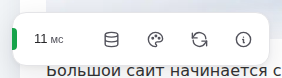
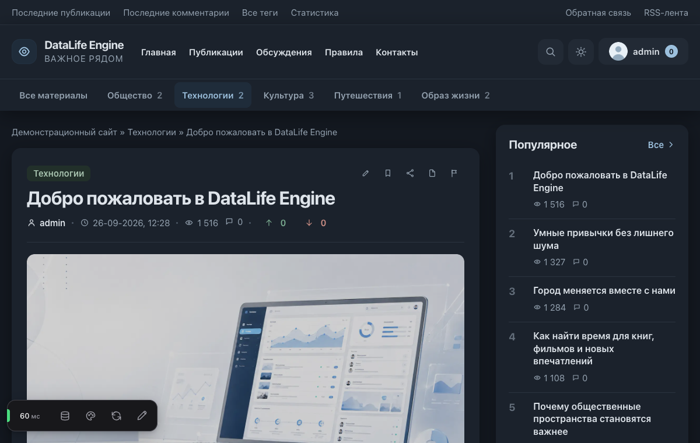
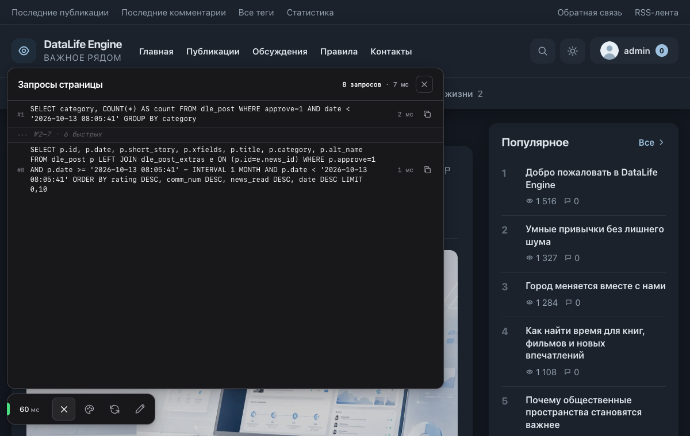
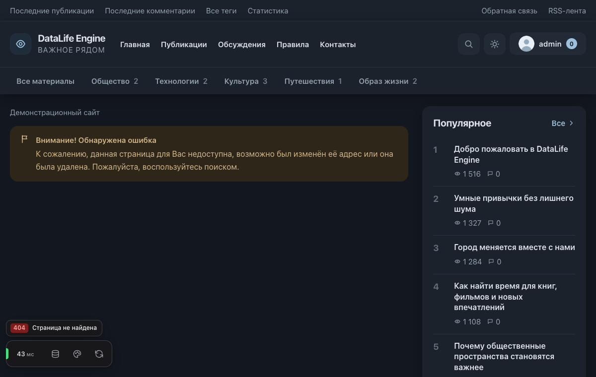
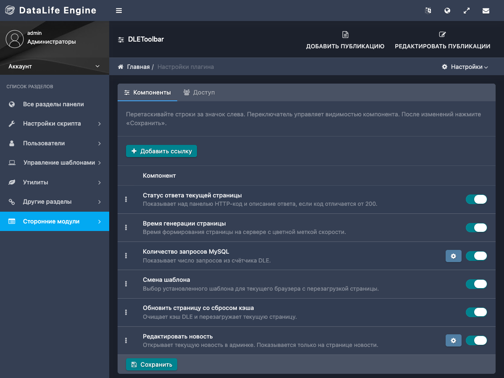
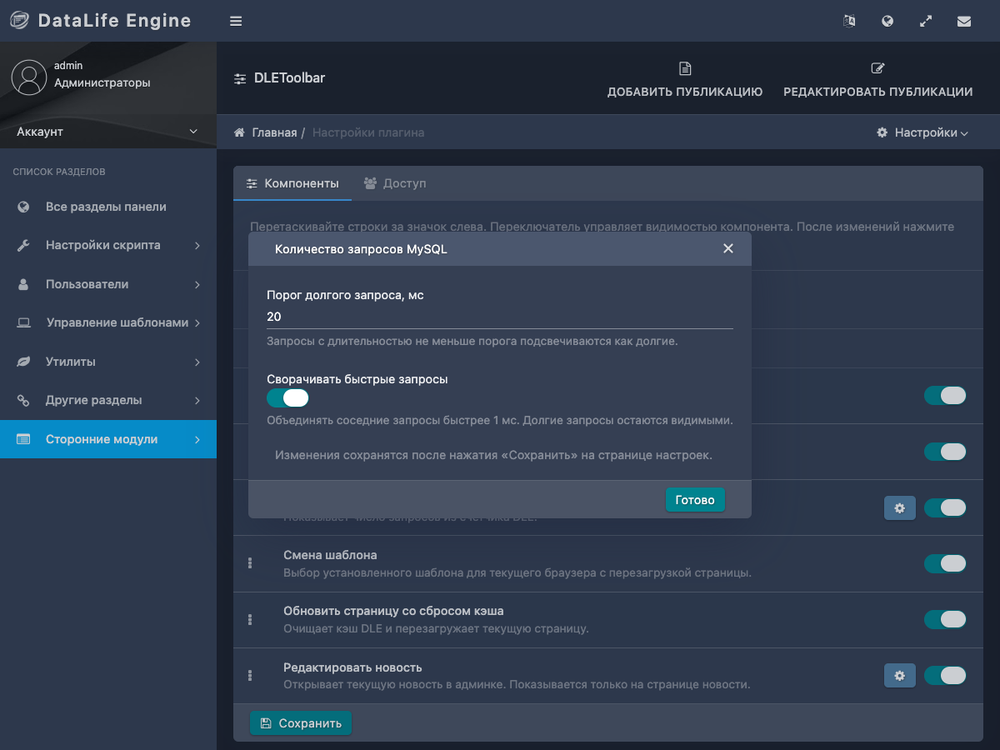
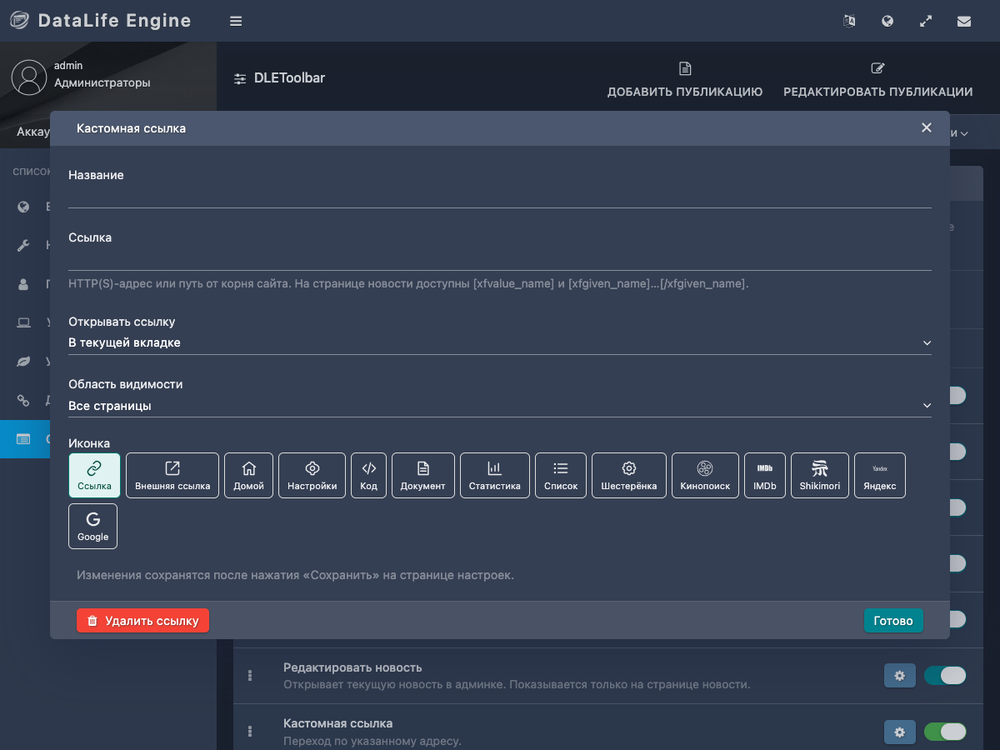
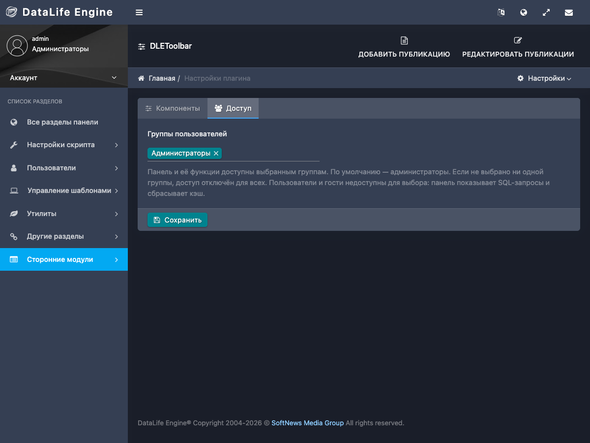

# DLEToolbar

Панель администратора для сайтов на DataLife Engine. Показывается поверх страниц
сайта только выбранным группам и не зависит от стилей шаблона: панель работает
в собственном Shadow DOM.





## Возможности

| Элемент | Что делает |
| --- | --- |
| Статус ответа | HTTP-код текущей страницы. |
| Время генерации | Время формирования страницы на сервере, мс. |
| Запросы MySQL | Число запросов страницы и панель со списком SQL: копирование, сворачивание быстрых запросов, порог долгого запроса. Экспериментальная настройка «Показывать источник запросов» (по умолчанию выключена) добавляет к запросам после инициализации панели файл и строку вызова, модуль или плагин по пути. С ней под заголовком списка появляется фильтр по инициатору: «Все», DLE, модули и плагины, запросы без источника; на каждой кнопке — число запросов и их суммарное время. Каждый инициатор получает свой цвет: им окрашены подпись источника и точка на кнопке фильтра (полоса слева остаётся только у долгих запросов как индикатор задержки). Быстрые запросы при этом сворачиваются вместе, только если у них один инициатор. Значения `password` и `hash` в запросах маскируются. В DLE 13.0–13.3 список не показывается: эти версии его не сохраняют. |
| Сброс кэша | Очищает кэш DLE и перезагружает текущую страницу. |
| Смена шаблона | Выбор установленного шаблона для текущего браузера (cookie `dle_skin`) с обычным обновлением страницы. |
| Пользовательские ссылки | Несколько независимых ссылок с названием, иконкой, выбором вкладки и области видимости. Поддерживают допполя текущей новости. |
| Редактировать новость | Ссылка на редактирование текущей новости в админке. Видна только на полной новости и только группам с правом редактирования новостей. |

Порядок элементов, их видимость и параметры настраиваются в админке.

Панель выводится только на обычных HTML-страницах сайта, которые DLE собирает
из `main.tpl`. Её нет в версии для печати, RSS, лентах Дзена и Турбо, ajax-ответах
и `sitemap.xml`. При печати страницы из браузера (Ctrl+P) панель скрывается.





## Требования

- DataLife Engine от 13.0 до 21.0.
- PHP 7.4 или новее.
- MySQL или MariaDB с InnoDB и `utf8mb4`.
- В `main.tpl` шаблона должен быть тег `{AJAX}`: панель выводится на его месте.

Проверенные сочетания: DLE 13.0–18.1 на PHP 7.4, DLE 19.0 и 21.0 на PHP 8.5.
Сброс кэша проверен с файловым кэшем DLE.

## Установка

1. Загрузите `DLEToolbar-<версия>.xml` из релиза в «Управление плагинами» админки DLE.
2. Откройте раздел DLEToolbar в админке (`admin.php?mod=dletoolbar`).
3. На вкладке «Компоненты» включите нужные элементы, расставьте их перетаскиванием,
   задайте параметры через кнопку настроек. Нажмите «Сохранить».
4. На вкладке «Доступ» выберите группы.

При изменении настроек появляется напоминание «Есть несохранённые изменения»;
панель с кнопкой «Сохранить» закрепляется внизу окна. Если вернуть сохранённые
значения, напоминание исчезнет, в том числе после ошибки проверки при сохранении.

До первого сохранения действуют настройки по умолчанию: панель доступна только
администраторам (группа 1), все элементы включены.

При смене шаблона панель записывает одноразовую cookie `dle_toolbar_skin` на
60 секунд и обновляет страницу. PHP проверяет доступ и токен DLE, устанавливает
штатную cookie `dle_skin`, удаляет одноразовую cookie и перенаправляет на тот же
адрес, чтобы DLE применил шаблон. Выбор «По умолчанию»
очищает `dle_skin`, чтобы использовать шаблон из настроек сайта.





## Пользовательские ссылки

На вкладке «Компоненты» нажмите «Добавить ссылку». Укажите название, адрес,
иконку, способ открытия и область видимости: все страницы, главная, категории
или полная новость. Ссылки можно независимо отключать, переставлять и удалять.
Добавление, изменение и удаление применяются после «Сохранить».

Адрес обязателен и принимает HTTP(S)-ссылку или путь от корня сайта, например
`/admin.php`. Если адрес пустой или недопустимый, настройки не сохраняются:
админка откроет окно этой ссылки и покажет ошибку.
На полной новости доступны допполя, которые разрешено видеть текущей группе:

- `https://example.com/search?q=[xfvalue_code]` — значение допполя кодируется
  как часть URL;
- `[xfvalue_url]` — значение допполя используется как полный адрес;
- `[xfgiven_url][xfvalue_url][/xfgiven_url]` — ссылка появляется только при
  заполненном допполе. Условия можно вкладывать друг в друга.

Ссылка с допполями скрывается вне полной новости, при отсутствующем значении
или недопустимом итоговом адресе. Условия заполненности следуют правилам версии
DLE, включая поля «Да/Нет».



## Доступ

Панель и все её функции получает каждая выбранная группа: список SQL-запросов
страницы с литеральными значениями и сброс всего кэша DLE. Выбрать можно только
группы, которым разрешён вход в админпанель DLE. Если группа потеряет этот доступ,
панель для неё отключится без изменения настроек. Если не выбрано ни одной группы, панель отключена
для всех.



Настройки плагина в админке доступны только администраторам. Сохранение
проверяет токен `user_hash` DLE.

## Обновление, отключение и удаление

- **Обновление** — загрузите новый XML поверх установленного плагина.
  Настройки сохраняются.
- **Отключение** — выключите плагин в «Управлении плагинами». Панель
  и обработка сброса кэша прекращаются, настройки сохраняются.
- **Удаление** — удалите плагин в «Управлении плагинами». Таблица
  `{prefix}_dletoolbar_settings` намеренно остаётся, чтобы переустановка
  плагина не стирала настройки. При повторной установке они подхватываются.
  Чтобы удалить настройки полностью, удалите таблицу вручную.

## Если что-то не работает

Ошибки плагина записываются в журнал ошибок PHP с префиксом `[DLEToolbar]`.
При ошибке инициализации панель не выводится, сайт продолжает работать.
При ошибке сохранения админка показывает сообщение и не сохраняет изменения.

Если панели нет на сайте:

- проверьте, что ваша группа выбрана на вкладке «Доступ»;
- проверьте, что в `main.tpl` шаблона есть `{AJAX}`;
- проверьте журнал PHP на записи `[DLEToolbar]`.

## Разработка

```sh
dleplugin test                       # тесты Pest в Docker
dleplugin static                     # статический анализ для PHP 8.4
dleplugin static --php-version 7.4   # статический анализ для PHP 7.4
dleplugin build --version <версия>   # сборка релиза в dist/DLEToolbar.xml
dleplugin check <каталог DLE>...     # применимость патчей
```

Версия плагина в `dleplugin.yml` не хранится: без `--version` в XML попадёт
пустая версия.

Для проверок используйте dleplugin v0.3.1 или новее: определения штатных
функций DLE, включая `set_cookie()`, входят в bootstrap анализатора.

### CI и выпуск релиза

CI запускается при push в `main` и pull request: статический анализ для PHP 8.4
и 7.4, тесты Pest, проверка сборки XML и браузерная регрессия.
Для релиза поставьте тег на коммит из `main` и отправьте его:

```sh
git tag -a vX.Y.Z -m vX.Y.Z && git push origin vX.Y.Z
```

Workflow проверит формат тега и принадлежность коммита к `main`, запустит CI,
соберёт плагин с версией `X.Y.Z` и опубликует GitHub Release с файлами
`DLEToolbar-X.Y.Z.xml` и `DLEToolbar-X.Y.Z.zip`. Внутри ZIP находится XML
с тем же именем, включающим версию.
Если релиз для этого тега уже существует, workflow завершится с ошибкой.

Правила кода — в `AGENTS.md`, предметная модель — в `CONTEXT.md`.

## Участие в разработке

Ошибки и предложения — через [issues](https://github.com/thecoooler/DLEToolbar/issues/new/choose).
Как прислать pull request — в [CONTRIBUTING.md](CONTRIBUTING.md). Уязвимости
сообщайте приватно, см. [SECURITY.md](SECURITY.md).

## Лицензия

[MIT](LICENSE).
